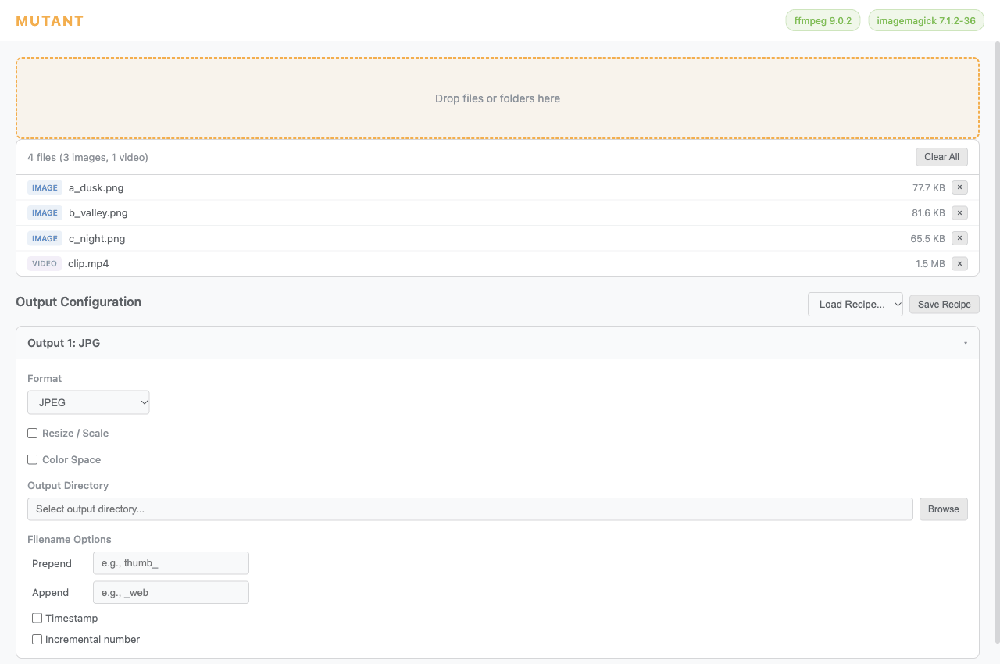
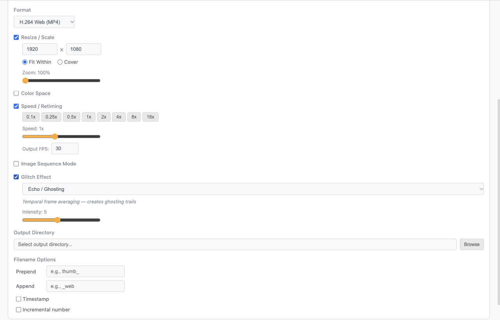

# Mutant

Desktop batch media converter built on ffmpeg and ImageMagick.

Documentation: [joshuacurry.dev/mutant](https://joshuacurry.dev/mutant)



Drag and drop files or folders, configure one or more outputs (format, resize, color space, speed, glitch effects, naming), and process everything in one go. It uses your locally installed **ffmpeg** and **ImageMagick**, so there's nothing to upload and no bundled codecs.

## Requirements

- [Node.js](https://nodejs.org/) 20.19+ or 22.12+ (required by electron-vite 6 and Vite 8)
- [ffmpeg](https://ffmpeg.org/) on `PATH`
- [ImageMagick](https://imagemagick.org/) 7+ on `PATH` (the `magick` command)

On macOS: `brew install ffmpeg imagemagick`. The header shows a badge for each tool it finds, with its version.

## Setup

```sh
git clone https://github.com/lucidbeaming/mutant.git
cd mutant
npm install
```

`npm install` rebuilds `better-sqlite3` for Electron's ABI (`postinstall`). If npm skipped install scripts, run `npx electron-builder install-app-deps`.

## Development

```sh
npm run dev
```

## Build

```sh
npm run dist
```

Builds the app with electron-vite and packages it with electron-builder into `dist/`: a `.dmg` on macOS, an installer on Windows, an AppImage on Linux. Builds aren't signed or notarized.

## Features

### Input

- Drag-and-drop files or entire folders
- Recursive scanning of directories for media files
- Supports common image formats (JPEG, PNG, WebP, AVIF, TIFF, BMP, GIF) and video formats (MP4, MOV, AVI, MKV, WebM, M4V, MXF)

### Output Configuration

- Multiple independent output configs per batch — a single input file can produce N outputs
- **Image formats:** JPEG, PNG, WebP, AVIF, TIFF
- **Video formats:** H.264 Web (MP4), ProRes (Proxy/LT/422/422HQ/4444), VP9 (WebM), H.264 (MOV)
- **Resize:** width/height bounds, fit-within or cover mode, zoom slider (100%–400%)
- **Color space:** sRGB, Adobe RGB, Display P3 (images) / BT.709, BT.2020 (video)
- **Speed / retiming (video):** 0.1× to 16× presets or a slider, with a set output frame rate
- **Image sequence mode (video):** turns all loaded images into one video, holding each for a set time (1/24 s to 10 s)
- **Glitch effects (video):** echo/ghosting, chromatic aberration, displacement, and motion-vector visualization, each with an intensity slider
- **Filename options:** prepend/append text, optional timestamp, optional incremental numbering, configurable positioning
- Each output targets its own directory



### Recipes

- Save and load named output configurations
- Auto-saves a "Last Session" recipe that restores on next launch
- Stored in SQLite at `mutant.db` in Electron's user-data folder (on macOS, `~/Library/Application Support/Mutant/` for a packaged build, or `.../mutant/` under `npm run dev`)

### Processing

- Sequential queue with per-operation progress reporting
- Cancellation support
- Filename collision handling (appends `_1`, `_2`, etc.)
- Error reporting per failed operation

## Tech Stack

- **Electron 45** + **React 18** + **TypeScript**
- **electron-vite 6** (Vite 8) for build tooling; **electron-builder** for packaging
- **fluent-ffmpeg** for video processing
- **gm** (in ImageMagick 7 mode) for image processing
- **better-sqlite3** for recipe storage
- ESLint and Prettier: `npm run lint`, `npm run format`

## How it works

The React renderer (`src/renderer`) has no Node access. It talks to the main process through a small preload API (`src/preload`). The main process (`src/main/services`) detects the tools, scans dropped paths for media, and runs one queue of operations (files × outputs) through `video-processor.ts` (ffmpeg) or `image-processor.ts` (ImageMagick), sending progress events back to the window.

## Related projects

- [ffmpeg-utilities](https://github.com/lucidbeaming/ffmpeg-utilities): a collection of ffmpeg scripts and snippets
- [channelswap](https://github.com/lucidbeaming/channelswap): color-swapped images from recombined RGB channels
- [audio-screenshotter](https://github.com/lucidbeaming/audio-screenshotter): screen + narration recording turned into captioned screenshots

## License

[MIT](LICENSE).
